<p align="center">
  
</p>

<p align="center">
  <a href="https://gustavodsb1.github.io/Minha-page-de-projetos-/"></a>
  <a href="https://www.linkedin.com/in/gustavo-ds-santos-borges"></a>
  <a href="https://www.instagram.com/gustavo_balieirob"></a>
  <a href="mailto:gustavosantos.mito2016@gmail.com"></a>
</p>

## `> cat sobre-mim.txt`

Desenvolvo para **web e Android**: sites, aplicativos e ferramentas que saem do papel e entram na rotina de quem usa,
do controle de diárias de um restaurante à contagem de estoque de uma loja.

A **Inteligência Artificial** é parte do meu processo todos os dias. Conheço a fundo como ela funciona e a uso para
planejar, escrever, revisar e testar código. Assim, uma ideia vira um produto funcionando em dias, não em meses.

Minha próxima fronteira é a **cibersegurança**: estudo hacking ético para entender como sistemas são invadidos e,
principalmente, como blindá-los. Quem sabe atacar sabe defender.

```js
const gustavo = {
  local:      "Rio Verde, Goiás",
  codigo:     ["JavaScript", "Kotlin", "Python", "HTML", "CSS"],
  plataforma: ["Web", "Android"],
  diaADia:    "IA em todas as etapas do desenvolvimento",
  estudando:  ["Cibersegurança", "Hacking ético"],
  buscando:   "Oportunidades em desenvolvimento web, Android e segurança da informação",
};
```

## `> ls ./stack`

<p align="center">
  
  
  
  
  
  
  
  
  
  
  
  
  
</p>

## `> ls ./projetos`

<table>
  <tr>
    <td><a href="https://github.com/GustavoDSB1/App-contagem-de-estoque-"></a></td>
    <td><a href="https://github.com/GustavoDSB1/App-planilha"></a></td>
  </tr>
  <tr>
    <td><a href="https://github.com/GustavoDSB1/mundo-achadinhoz"></a></td>
    <td><a href="https://github.com/GustavoDSB1/toprioverde"></a></td>
  </tr>
</table>

<p align="center"><a href="https://gustavodsb1.github.io/Minha-page-de-projetos-/"><b>Ver todos os projetos com imagens e detalhes no meu portfólio</b></a></p>

## `> git log --graph`

<p align="center">
  <picture>
    <source media="(prefers-color-scheme: dark)" srcset="https://raw.githubusercontent.com/GustavoDSB1/GustavoDSB1/output/cobrinha-escura.svg" />
    <source media="(prefers-color-scheme: light)" srcset="https://raw.githubusercontent.com/GustavoDSB1/GustavoDSB1/output/cobrinha.svg" />
    
  </picture>
</p>

<p align="center">
  
</p>
